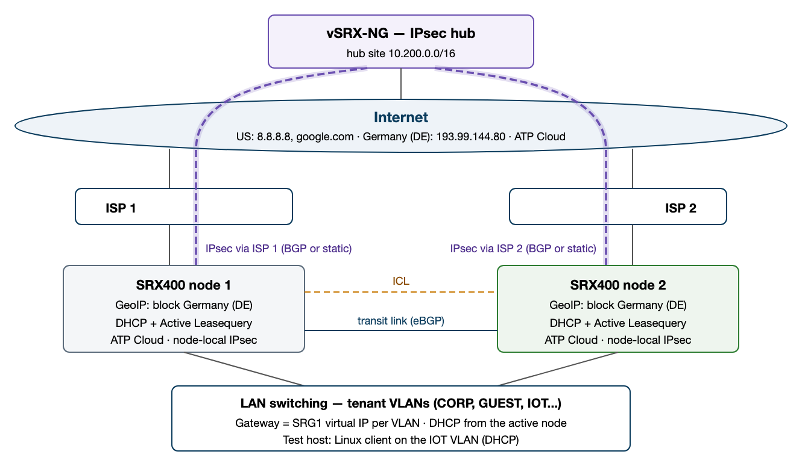

# SRX400 MNHA Secure Branch under Juniper Mist

**Eric Sandoval**, Network Security Architect, HPE

Two SRX400 nodes, two ISPs, one Mist Hub Profile per node: a lab-validated branch design with profiles you can import.
Design, test results and build order: **[the paper (PDF)](docs/SRX400-MNHA-Secure-Branch-Design.pdf)**.

## What is this

- An SRX400 Multinode High Availability (MNHA) pair in hybrid mode, managed by Juniper Mist with one **Hub Profile** per node (not a WAN Edge Template).
- Why Hub Profiles: each node keeps its own MNHA values (IDs, addresses, priority) in its own profile. Both SRX400 nodes stay overlay spokes (paper 4.2).
- Dual ISP, one per node, with per-tenant ISP steering and mutual backup; IPsec overlay to a vSRX hub; DHCP with lease sync; GeoIP.
- Built and tested in the author's lab. Release: SRX400 on Junos OS Evolved 25.4X300-D30; vSRX hub on Junos OS 24.4R2-S4.12.
- **LAB ONLY in these files:** the WAN sits in `WAN-VR` and management is out-of-band. A production build keeps the WAN in inet.0 (paper 5.4). See Good to know.

## What's in this repo

| File | What it is | Use it for |
|---|---|---|
| [docs/SRX400-MNHA-Secure-Branch-Design.pdf](docs/SRX400-MNHA-Secure-Branch-Design.pdf) | The design paper | How it works, results, build order (section 8), not yet tested (section 9) |
| [docs/topology.png](docs/topology.png) | Topology diagram (paper section 1) | A quick overview |
| [mist/srx400-node1.json](mist/srx400-node1.json) | Hub Profile `SRX400-1`: native settings + Additional CLI | Import into Mist for SRX400 node 1 |
| [mist/srx400-node2.json](mist/srx400-node2.json) | Hub Profile `SRX400-2`: native settings + Additional CLI | Import into Mist for SRX400 node 2 |
| [mist/vsrx-hub.json](mist/vsrx-hub.json) | Hub Profile `HUB` for the vSRX hub | Import into Mist for the hub. The node profiles' overlay needs it (path `HUB-wan`, `<hub-MAC>`) |
| [junos/srx400-node1.set](junos/srx400-node1.set), [junos/srx400-node2.set](junos/srx400-node2.set) | Each node's as-built lab configuration in `display set` form | Reading, diffing, or a CLI build |

## Design at a glance

- **MNHA hybrid, SRG1 (services redundancy group 1) active/backup.** Node 1 activeness-priority 200, node 2 100. Six tenant gateway virtual IPs (`.1`) on `ge-0/0/3`, which SRG1 monitors. No preemption: failback is manual.
- **ICL (inter-chassis link) on `ge-0/0/4`** (10.255.0.1/30 and .2, zone `HA`): MNHA control, session sync and the MNHA forwarding path.
- **Inter-node transit link on `ge-0/0/5`** (10.255.2.1/30 and .2, zone `ICD`): eBGP AS 65001 (node 1) to AS 65002 (node 2) in `WAN-VR`, BFD 300 ms x 3.
- **One ISP per node on `ge-0/0/2` (DHCP):** ISP 1 on node 1 (WAN port `wan`), ISP 2 on node 2 (`wan2`). Per-node interface source NAT.
- **Per-tenant steering with mutual backup:** MGMT, CORP, MEDIA, SECURITY and IOT (virtual router `lan`) use ISP 1; GUEST (`GUEST-VR`) uses ISP 2. A tenant whose ISP is on the peer crosses `ge-0/0/5`.
- **DHCP** from the SRG1-active node, with Active Leasequery to the peer (`lan` peer on MGMT, `GUEST-VR` peer on GUEST).
- **IPsec overlay:** each node runs its own (node-local) IKEv2 tunnel and iBGP with BFD to the vSRX hub (Mist VPN `OrgOverlay`). The SRG1-active node advertises IOT with local-preference 200.
- **GeoIP on IOT:** `GEO-BLOCK-DE` denies IOT traffic to Germany (DE) on both exit paths, IOT to WAN and IOT to ICD.

## Security zones and the transit link (zone ICD)

| Zone | Interfaces | Purpose |
|---|---|---|
| `MGMT` `CORP` `GUEST` `MEDIA` `SECURITY` `IOT` | `ge-0/0/3.0` (VLAN 10, untagged), `.20` `.30` `.40` `.50` `.60` | One zone per tenant network (Mist) |
| `wan` (node 1), `wan2` (node 2) | `ge-0/0/2.0` | The node's own ISP (DHCP) and tenant source NAT (Mist) |
| `vpn_OrgOverlay` | `st0.0`, `lo0.1` | IPsec overlay to the hub (Mist) |
| `HA` | `ge-0/0/4.0`, `lo0.0` | MNHA ICL and forwarding addresses (Additional CLI) |
| `ICD` | `ge-0/0/5.0` | Inter-node transit link: eBGP and cross-node traffic (Additional CLI) |

`ICD` is only the name of the zone and BGP group on the `ge-0/0/5` transit link. It is not the MNHA ICD: MNHA forwarding uses the ICL (paper 4.4). Detail: paper sections 4.4 and 5.4.

- **Reaching the other node's ISP:** each tenant uses one ISP. If that ISP is on the other node, the tenant's traffic crosses `ge-0/0/5` and is source-NATed there.
- **Fallback:** without the peer's default, the tenant uses the local ISP. Internet traffic on that fallback is not yet tested (paper 9).
- **The routes behind it:** each tenant virtual router (`lan`, `GUEST-VR`) has a static default `next-table WAN-VR`. On the node without the tenant's ISP it has preference 200, so the peer's BGP default (170) wins and the tenant crosses `ge-0/0/5`.
- **Sent to the peer (`WAN-EXPORT`):** the node's own ISP default; the six tenant /24s, only from the SRG1-active node (condition `MNHA-ACTIVE`); hub-site routes from the node's own tunnel. Everything else is rejected.
- **Taken from the peer (`ICD-IMPORT`):** hub-site routes (10.200.0.0/16 and longer) at preference 175, so the node's own overlay routes (170) win. Rib-group `WAN-LEAK` copies the peer's default into `lan` and `GUEST-VR`.
- **Policy and NAT:** `xnode-out` (ICD to `wan`/`wan2`) and `xnode-iot` (ICD to `vpn_OrgOverlay`) permit traffic from the peer. `ICD_to_wan` (node 1) and `ICD_to_wan2` (node 2) source-NAT it to the egress node's WAN interface.

## Import into Mist

Before you start (paper 8, step 0):
- The two SRX400 nodes and the vSRX hub claimed or adopted into one Mist org and connected.
- LAN switch: VLAN 10 untagged and VLANs 20, 30, 40, 50 and 60 tagged on the trunk to `ge-0/0/3` of both nodes.
- Out-of-band management on each node that reaches Mist, DNS, NTP and ATP Cloud (see Good to know), and each chassis serial entitled for ATP Cloud.

### 1. Create the org objects first

The Hub Profiles reference these by name. Create them before the profiles, the VPN first (the IOT network refers to it):
- VPN `OrgOverlay`: hub-and-spoke, one path `HUB-wan`, BFD profile `broadband`.
- Organization > WAN > Applications: `HUB-SITE-NETS`, custom, 10.200.0.0/16, protocol any.
- Organization > WAN > Networks: the six networks below, Internet access on. IOT also gets VPN access to `OrgOverlay` (routed, no re-advertise to the overlay).

| Network | VLAN | Subnet | Gateway |
|---|---|---|---|
| MGMT | 10 | 10.10.10.0/24 | 10.10.10.1 |
| CORP | 20 | 10.10.20.0/24 | 10.10.20.1 |
| GUEST | 30 | 10.10.30.0/24 | 10.10.30.1 |
| MEDIA | 40 | 10.10.40.0/24 | 10.10.40.1 |
| SECURITY | 50 | 10.10.50.0/24 | 10.10.50.1 |
| IOT | 60 | 10.10.60.0/24 | 10.10.60.1 |

### 2. Replace the placeholders

| Placeholder | What to put |
|---|---|
| `<NODE1-MGMT-IP>`, `<NODE2-MGMT-IP>`, `<HUB-MGMT-IP>` | Out-of-band management address of each device (`oob_ip_config`; the files set netmask `/24`) |
| `<mgmt-gateway>` | Out-of-band management gateway (`oob_ip_config` and the LAB ONLY inet.0 default) |
| `<hub-MAC>` | The hub's MAC address as Mist shows it: 12 lowercase hex digits, no separators (IKE gateway name in the DPD lines) |
| `<region>` | Your ATP Cloud region, as in the enrollment URL (paper 3.1) |

- `<*>` in the Additional CLI is Junos wildcard syntax: keep it.
- Each node file also carries its own copy of the six networks (key `networks`): keep it the same as the org networks.
- Hub WAN: use your own address in place of 172.16.11.2/30, gateway 172.16.11.1 (`mist/vsrx-hub.json`; the nodes' IKE gateway address).
- Hub-site prefixes: use your own in place of 10.200.0.0/16 (application `HUB-SITE-NETS` and the Additional CLI of all three files). The hub's discard route and test host 10.200.8.1/32 on `lo0.1` are LAB ONLY (paper 4.5).
- Nodes not yet enrolled in ATP Cloud: take the four `# [after enrollment]` blocks (each runs to the next `#` line) out of both node files. Add them back in place after enrollment (paper 8 steps 7-9).

### 3. Import the Hub Profiles

Organization > WAN > Hub Profiles > Import Profile. Choose the file, type the Name, then Import. Import creates and saves the profile at once.

| File | Name |
|---|---|
| `mist/vsrx-hub.json` (import it first) | `HUB` |
| `mist/srx400-node1.json` | `SRX400-1` |
| `mist/srx400-node2.json` | `SRX400-2` |

- Keep the name `HUB`: the VPN path `HUB-wan` is built from it and the hub's WAN port name `wan`.
- Import tested in a lab Mist org (placeholders filled in, VPN under a test name): `SRX400-1` and `SRX400-2` through this dialog; the org objects and `HUB` through the Mist API.

### 4. Assign each profile to its device

- `HUB` to the vSRX hub first (confirm it is connected), then `SRX400-1` to node 1 and `SRX400-2` to node 2 (paper section 8).
- Importing does not assign a profile. After each assignment, confirm the Mist commit on the device: `show system commit`.
- Keep the Additional CLI in the profile: a device-level list replaces the profile's list (paper 4.2).

## Using the set files

- `junos/*.set`: each node's as-built lab configuration (Mist render + Additional CLI + ATP Cloud enrollment lines) with this repo's generic values.
- Not a Mist render of the files in `mist/`: a few lines derived, some blocks reordered. Left out: adoption lines, secrets, DHCP reservations, some management access settings, `set version` and a few box-local lines.
- Use them to read or diff a node (`show configuration | display set`), or for a CLI build. Replace the placeholders listed in each file's header first.

## Good to know

- **LAB ONLY:** `WAN-VR` holds the WAN port `ge-0/0/2` with `ge-0/0/5`. The only default in inet.0 is the out-of-band management default `0.0.0.0/0 qualified-next-hop <mgmt-gateway> preference 1`.
- **So management is out-of-band:** each node reaches Mist, DNS, NTP and ATP Cloud only through `re0:mgmt-0`. A production build keeps the WAN in inet.0 (paper 5.4); that variant is not yet tested.
- **The transit link carries tenant traffic:** GUEST crosses `ge-0/0/5` in steady state (node 1 active). After a failover to node 2, the five `lan` tenants cross it instead (paper 3.4, 4.3).
- **Failover:** firewall sessions are synchronized; IPsec security associations are not (each tunnel is node-local). Established sessions across a failover are not yet tested; the results use pings (paper 3.7, 9).
- **DHCP, if the nodes run 25.4X300-D30.2:** add `dhcp-local-server overrides no-unicast-replies` to `lan` and `GUEST-VR` in both node profiles (paper 3.6, 5.5). These files do not carry it. Pushing it from the profiles is not yet tested; the `GUEST-VR` line is not tested by any method.
- **Not yet tested:** paper section 9 lists every open item, for example ICL loss and split-brain, transit link failure and a fresh node build.

> Lab-validated reference by the author. It is not an official Juniper Networks or HPE position or support
> statement. Verify every line in your own lab before use.
